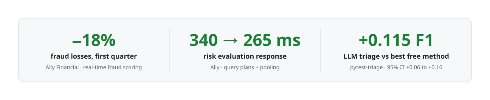

<!-- Generated by scripts/build_readme.py from scripts/README.template.md. Edit those, not this file. -->

<picture><source media="(prefers-color-scheme: dark)" srcset="https://raw.githubusercontent.com/shashank11yadav/shashank11yadav/output/hero-dark.svg"></picture>

<a href="https://www.shashankyadav.dev/"><picture><source media="(prefers-color-scheme: dark)" srcset="./Assets/profile/btn-portfolio-dark.svg"></picture></a>
<a href="https://www.linkedin.com/in/shashank-yadav-cs/"><picture><source media="(prefers-color-scheme: dark)" srcset="./Assets/profile/btn-linkedin-dark.svg"></picture></a>
<a href="https://x.com/Shashankyadav30"><picture><source media="(prefers-color-scheme: dark)" srcset="./Assets/profile/btn-x-dark.svg"></picture></a>
<a href="mailto:yadav.shashank1201@gmail.com"><picture><source media="(prefers-color-scheme: dark)" srcset="./Assets/profile/btn-email-dark.svg"></picture></a>
<a href="https://www.shashankyadav.dev/resume.pdf"><picture><source media="(prefers-color-scheme: dark)" srcset="./Assets/profile/btn-resume-dark.svg"></picture></a>
<a href="https://leetcode.com/u/Shashank-yadav/"><picture><source media="(prefers-color-scheme: dark)" srcset="./Assets/profile/btn-leetcode-dark.svg"></picture></a>

<picture><source media="(prefers-color-scheme: dark)" srcset="./Assets/profile/impact-dark.svg"></picture>

<picture><source media="(prefers-color-scheme: dark)" srcset="./Assets/profile/h-about-dark.svg"></picture>

I'm an AI/ML engineer in Denver with 3+ years of building production software. I build LLM features, retrieval systems and ML models, and the backend services they run on. At **Ally Financial** I added an LLM to a real-time fraud risk pipeline, with guardrails and validation that meet banking audit requirements, on a fraud detection platform I helped build from the ground up. Before that, I shipped Java/Spring Boot features to a core banking platform at **TCS** and led its zero-downtime Oracle → PostgreSQL migration. I have an MS in Computer Science from **UMass Boston** (2025).

I like proof: every project below comes with the numbers that show it works, and with what those numbers don't show.
<!-- Add work-authorization status here, e.g. "F-1 STEM OPT, no sponsorship needed until 20XX". -->

<picture><source media="(prefers-color-scheme: dark)" srcset="./Assets/profile/h-experience-dark.svg"></picture>

<b>Software Developer · Ally Financial</b> · 07/2025 – present · Remote, USA Real-time fraud detection: fraud losses −18% in the first quarter after launch

 

- Added an LLM to a real-time transaction risk scoring pipeline to write explanations of flagged activity for fraud analysts, with prompt guardrails and validation, built with the AI and compliance teams, that meet banking audit requirements.
- Owned the core scoring services (Python, streaming and caching) of a real-time fraud detection platform built from the ground up. In its first quarter, fraud losses fell by **18%**.
- Cut average response time for risk evaluation and alerting from **340 ms to 265 ms** by reworking query plans and adding connection pooling.
- Built a live fraud analytics dashboard (React, TypeScript) that replaced spreadsheets analysts were updating by hand, cutting average investigation time by **~21%**.
- Set up CI/CD with containerized deployments, structured logging and metrics dashboards, so on-call engineers pinpoint issues in minutes instead of hours.
- Owned service authentication (OAuth 2.0, JWT) for compliance requirements, backed by **85+ automated tests** that run on every pull request, with **>90% coverage** on critical paths.

<b>Graduate Teaching Assistant · University of Massachusetts Boston</b> · 09/2024 – 05/2025 · Boston, MA 8 lab cohorts, 90+ students, feedback within 24 hours

 

- Led 8 lab cohorts (**90+ students**) through circuit analysis and MATLAB simulations.
- Gave feedback on **70+ lab reports**, each within 24 hours.
- Mentored student pairs on debugging and problem solving.

<b>Software Engineer · Tata Consultancy Services</b> · 08/2022 – 08/2023 · Gurgaon, India Core banking: zero-downtime Oracle → PostgreSQL migration, $45K/yr saved

 

- Shipped 7 Java/Spring Boot features to a core banking platform that processes **50K+ transactions a day**. Wrote 120+ JUnit tests and owned the Jenkins pipeline, which cut the defect rate by **40%** versus the previous release cycle.
- Led a **zero-downtime migration of a 20 GB production database** from Oracle to PostgreSQL. Refactored 15K lines of SQL and application code and re-indexed critical queries, which saved **$45K/year** in licensing and cut **4 s** from page loads.
- Managed a 6-person Tier-2 support team. A structured triage process raised SLA compliance (tickets resolved within 24 h) from **~65% to 90%**.
- Automated nightly reporting with Bash and cron, removing ~5 hours a week of manual work and alerting on production anomalies.

<b>Software Development Engineer Intern · NTT Data</b> · 01/2021 – 07/2022 · Remote, India Enterprise apps: Spring Security hardening, weekly releases

 

- Built Angular/TypeScript components and Spring Boot APIs, plus a Kafka order-processing microservice handling 2K+ transactions a day.
- Added authentication and role-based access (Spring Security, OAuth2, JWT) and fixed input-validation gaps from a security audit. There were zero auth-related incidents after launch.
- Added JUnit/Mockito stages and SonarQube quality gates to GitHub Actions, which helped the team move from biweekly to weekly releases with fewer rollbacks.

<picture><source media="(prefers-color-scheme: dark)" srcset="./Assets/profile/h-work-dark.svg"></picture>

### [pytest-triage](https://github.com/shashank11yadav/pytest-triage)
A triage assistant for pytest's GitHub issues that runs in shadow mode: it suggests labels, missing information and likely duplicates, never writes to GitHub, and is scored against what the maintainers actually did. [Live results, updated daily](https://shashank11yadav.github.io/pytest-triage/)

<b>Problem and approach</b> · why it exists and how it works

 

**Problem:** since January 2025, 247 of pytest's 484 new issues (51%) never got a label. Triage is the first thing to slip when volunteers are busy.

**Approach:** a fixed pipeline of three cheap LLM calls plus local search, with enum-only outputs, injection guardrails and a policy check. By default a label is shown only when a trained classifier agrees with it, and every choice is made on a 2024 dev split before the test set is scored.

- Labels (11 labels): **macro-F1 0.58** vs 0.46 for the best free method, a logistic-regression classifier (**+0.115**, 95% CI +0.06 to +0.16).
- High-precision mode, the default: **82% of shown labels match the maintainers'** (95% CI 69 to 91%), on 18% of issues. Showing every suggested label would be 46% precise.
- A guided human check of the type labels found the model calling regressions "bug", so I added **`type: regression`**: F1 0.71, vs 0.47 for the best free method.
- Duplicates: **7 of 15 known pairs flagged, 3 of 30 false alarms** (search alone finds 5).
- Prompt injection: **0 of 104 attack runs reached a maintainer** (19 attacks, most in 6 variants).
- About **$0.0015 and 3.3 s per issue**; $2.64 spent on building and evaluating everything. A CI regression gate fails any prompt or model change that hasn't been re-measured.

`Python · Gemini · BM25 + embeddings · scikit-learn · bootstrap evals · GitHub Actions · Docker`

<b>Inside pytest-triage</b> · how one issue flows through it

 

<picture><source media="(prefers-color-scheme: dark)" srcset="./Assets/profile/triage-dark.svg"></picture>

<b>How these numbers are measured</b> · what they show and what they don't

 

- **Split by time:** examples come from issues before 2024, every choice (prompt, model, thresholds) is made on 256 issues from 2024, and the 237 test issues from 2025 onward are scored once per final choice. Few-shot examples and duplicate candidates are always older than the issue being triaged.
- **Is the gap real?** Paired bootstrap, 2,000 resamples. With 11 to 44 examples per label, gaps under about 0.03 are noise. Most of prompt v4's gain is the new label; on the original ten labels it is level with v3s.
- **Rules fixed in advance:** v4 was adopted only because it stayed within 0.01 of v3s on the original labels and beat the kNN vote on regressions, both on dev. The high-precision threshold (0.90) was the lowest that reached 70% precision on dev, then applied once to test.
- **Precision against incomplete labels:** measured precision is 0.43, but maintainers apply about 1 label per issue and often leave the type blank. Two model raters put overall precision at about 0.65 to 0.75. A guided human check of 50 disputed type labels (46 judged correct, kappa 0.56 against a blind model rater) puts type precision at 0.71 to 0.95. The rater's warm-up score was 6 of 10, below the 7 set in advance, so treat this as supporting evidence.
- **Optimistic numbers:** the duplicate design and the injection fixes were measured on the data used to make them. The fairer injection estimate is the run before the fixes (1 of 104 reached a maintainer), and I wrote the attacks myself.
- **Not yet used by maintainers:** the daily shadow run scores issues that didn't exist when the code was written, recording both the labels shown and everything the model suggested.

### [Ask the Filings](https://github.com/shashank11yadav/ask-the-filings)
Ask a question about a company's annual report (SEC 10-K) and get an answer with the exact passages it came from. If the filings don't contain the answer, it says so instead of guessing. [Watch the demo](https://github.com/user-attachments/assets/64ae15e5-2de7-44b7-a403-27f4e7530134)

<b>Problem and approach</b> · why it exists and how it works

 

**Problem:** an answer about a filing is only useful if you can check it, and if it admits when the filing doesn't say.

**Approach:** hybrid search (pgvector + Postgres full-text, merged with RRF), company detection and a local cross-encoder reranker, then Gemini answering in JSON with citations. Guardrails refuse investment advice, predictions and off-topic questions with fixed responses written in code, withhold answers without a valid citation, and flag numbers that aren't in the cited passages. Each design choice was kept or dropped based on the eval.

- **111 of 117 answerable questions correct (95%) and 0 wrong answers**: the other 6 were "not found in the retrieved passages". It also refused **26 of 27 unanswerable questions** (other companies or years, predictions, undisclosed figures, false premises).
- Checked in code, not by the LLM judge: the main figure is right on 65 of 67 numeric questions, and every number in 112 of 112 answers appears in the cited passages. **21 of 21** guardrail tests pass.
- Retrieval when the system has to work out the company itself: embeddings alone 0.60, hybrid 0.74, **hybrid + reranker 0.89** recall@8. Company detection alone took it from 0.77 to 0.88.
- **$0.007 per question**, 5.5 s median (8.7 s p95). Embedding and reranking run locally, so only the final Gemini call costs money.

`Python · Postgres/pgvector · bge embeddings + reranker · Gemini · Streamlit · Docker`

<b>Inside Ask the Filings</b> · ingestion and the query path

 

<picture><source media="(prefers-color-scheme: dark)" srcset="./Assets/profile/filings-dark.svg"></picture>

<b>How these numbers are measured</b> · what they show and what they don't

 

- **The set:** 144 questions over 10 companies' 10-Ks (two fiscal years each). 117 the filings answer and 27 they don't, in five kinds: company not loaded, year not loaded, prediction, not disclosed, false premise. Questions don't say which company or year to search.
- **How I built and graded the set:** I generated the answerable questions from filing passages and grade the answers with an LLM judge from the same model family, which tends to be generous. To offset that, I check every number in code, and every question has to pass my automatic checks: the quoted evidence exists in the filing, the answer's numbers appear in it, and the question names the company. The 27 unanswerable questions were written separately.
- **Uncertainty:** 111 of 117 has a 95% interval of roughly 89 to 98%. `evals/compare.py` runs a paired McNemar test and a bootstrap interval before I call any change a win.
- **Small guardrail set:** 21 cases show the basics work (advice, off-topic, hidden instructions in the question or in fake retrieved passages), not that the system is hard to attack.
- **Next:** I'm adding a second judge from a different model family, so I can measure how often the two agree.

### [SyncScribe](https://github.com/shashank11yadav/SyncScribe)
A real-time collaborative editor with GitHub sign-in, owner/editor/viewer sharing and version history, on a self-hosted Yjs sync server. [Live demo](https://shashank11yadav.github.io/SyncScribe/) (runs in your browser and syncs between your own tabs)

<b>Problem and approach</b> · why it exists and how it works

 

**Problem:** people editing one document need each other's changes and cursors instantly, and a viewer must not be able to write, even with a modified client.

**Approach:** Tiptap on Yjs (a CRDT) in a Next.js app, synced through a self-hosted Hocuspocus server instead of a hosted service. The web app checks access in one place for every action and mints a two-minute token per user, document and role. The sync server re-checks the role in Postgres, drops a viewer's writes and closes sockets as soon as access is revoked.

- Every permission rule is tested three ways: a role-matrix test, integration tests of each server action against real Postgres, and websocket tests with real clients (expired, foreign-document or wrong-secret tokens, and a token claiming more than the database grants). Token tampering and `alg: none` are covered by unit tests, and forged roles by the integration tests. **241** unit and integration tests and **20** Playwright end-to-end tests, including two browsers co-editing, live revocation, axe accessibility checks and a 375px layout.
- Removing someone cuts off their open session within a second: Postgres LISTEN/NOTIFY tells the sync server, which closes the socket. No Redis or queue.
- A CRDT can't delete content on the server, because a client holding old state would merge it back. So restoring a version writes the old text as a new edit, and saves the current text first.
- Sharing never reveals whether an email has an account; it always creates a pending invite.
- The live demo is a static GitHub Pages build of the same editor, role rules and Markdown export: tabs sync over BroadcastChannel, documents and versions live in IndexedDB, and a strict CSP plus end-to-end checks make sure it never contacts another host.
- CI runs lint, typecheck, tests and both end-to-end suites; CodeQL and Dependabot watch the code, and every Action is pinned to a commit SHA.

`Next.js · TypeScript · Yjs · Hocuspocus · Tiptap · Auth.js · Postgres · Drizzle · Playwright`

<b>Inside SyncScribe</b> · sign-in, access checks and real-time sync

 

<picture><source media="(prefers-color-scheme: dark)" srcset="./Assets/profile/syncscribe-dark.svg"></picture>

<b>Limits and history</b> · what it doesn't do yet

 

- **The full app isn't hosted.** Free tiers for the database, sync server and web host all sleep when idle, so the always-on demo shows the editing experience and the full app runs locally with Docker.
- **The demo syncs within one browser only,** and its "Open as viewer" tab is a UI preview: with no server, a modified client could still write. In the full app the sync server refuses those writes.
- **One sync instance.** Hocuspocus keeps each document in one process; scaling out needs the Redis extension and sticky routing.
- **Where it started:** the first version followed the JavaScript Mastery "LiveDocs" tutorial on Liveblocks and Clerk. This is a rewrite with a different architecture, and none of that code remains.

<!--
When you enable this section, renumber the headers after it in scripts/render_svgs.py (SECTIONS).

<picture><source media="(prefers-color-scheme: dark)" srcset="./Assets/profile/h-opensource-dark.svg"></picture>

**<Project>** · <N> merged pull requests
<One sentence: what the change does and why it mattered.> ([#1234](https://github.com/<org>/<repo>/pull/1234))

**<Project>** · <N> merged pull requests
<One sentence.> ([#5678](https://github.com/<org>/<repo>/pull/5678), [#5690](https://github.com/<org>/<repo>/pull/5690))
-->

<picture><source media="(prefers-color-scheme: dark)" srcset="./Assets/profile/h-interview-dark.svg"></picture>

**More retrieval candidates made duplicate detection worse.** In pytest-triage, merging the LLM's expansion queries into one ranked pool pushed easy duplicates out of the top 100. Keeping the issue's own top 8 and adding the expansion results as a separate pool raised recall from 6/15 to 10/15.

**My precision number was wrong because the ground truth was incomplete.** In pytest-triage, maintainers apply about 1 label per issue and often leave the type blank, so measured precision was 0.43. Two model raters, then a guided human check of 50 disputed type labels, put it at about 0.65 to 0.75 overall and 0.71 to 0.95 for types. The same check showed the model calling regressions "bug", so I added `type: regression` (F1 0.71).

**An 8-point win that was noise.** In Ask the Filings, a table-aware chunker beat the plain one by 8 points on the first 60 questions. Re-tested on a larger, newer question set sampled from the filing text, it fixed 9 answers and broke 7 (McNemar p = 0.80). I kept the simpler chunker and added a paired test to every comparison.

**340 ms → 265 ms came from the database layer.** At Ally, reworking the query plans behind risk evaluation and alerting and adding connection pooling cut average response time by about a fifth. <!-- Add what you found: which query, what the plan was doing, how you measured it. -->

<picture><source media="(prefers-color-scheme: dark)" srcset="./Assets/profile/h-toolbox-dark.svg"></picture>

| Area | Tools | Where I've used them |
| :--- | :--- | :--- |
| **Languages** | Python, Java, TypeScript, C++, SQL, Bash | Python at Ally; Java at TCS and NTT Data |
| **Backend & APIs** | Spring Boot, FastAPI, gRPC, REST, WebSockets, OAuth 2.0/JWT | Ally fraud platform, TCS core banking, NTT Data |
| **Streaming & data** | Kafka, Redis, PostgreSQL (incl. pgvector), Oracle, MongoDB | Ally fraud platform, TCS Oracle → Postgres migration, Ask the Filings |
| **Cloud & delivery** | AWS (Lambda, Fargate, EKS, S3, SQS), Docker, Kubernetes, GitHub Actions, Jenkins | Ally delivery pipeline, TCS Jenkins pipeline |
| **ML & LLM systems** | PyTorch, Hugging Face Transformers, RAG, hybrid retrieval, rerankers, LLM guardrails | pytest-triage, Ask the Filings, AccuScan, Ally fraud explanations |
| **Quality & reliability** | pytest, JUnit/Mockito, SonarQube, Prometheus/Grafana, bootstrap evals | 85+ tests at Ally, 120+ JUnit tests at TCS, eval-backed project results |

<picture><source media="(prefers-color-scheme: dark)" srcset="./Assets/profile/h-activity-dark.svg"></picture>

Public activity only: work I do for employers lives in their repositories, so it doesn't show up here. Redrawn every 6 hours from GitHub's contribution calendar.

<picture><source media="(prefers-color-scheme: dark)" srcset="https://raw.githubusercontent.com/shashank11yadav/shashank11yadav/output/activity-dark.svg"></picture>

---

**Building LLM features, retrieval or evals? I'd like to hear about it.** 
I'm looking for AI/ML engineer roles, and I can start immediately.

**Denver, CO · Open to on-site, hybrid and remote work, and to relocation** 
[Email](mailto:yadav.shashank1201@gmail.com) · [LinkedIn](https://www.linkedin.com/in/shashank-yadav-cs/) · [Portfolio](https://www.shashankyadav.dev/) · [X](https://x.com/Shashankyadav30)

Plain-text version of the images

**Activity:** a year of public GitHub contributions, one cell per day, with totals, active days, streaks and the busiest day; redrawn every 6 hours.

**Shashank Yadav**: AI/ML engineer, open to AI/ML engineer roles. Builds LLM features, retrieval systems and evals, and the backend services they run on. MS Computer Science, UMass Boston (2025) · based in Denver, CO, open to on-site, hybrid and remote work · Software Developer at Ally Financial. Stream (Kafka, Redis) → serve (gRPC, Spring, FastAPI) → retrieve (pgvector, BM25, RRF) → evaluate (bootstrap CIs, audits).

**Results:** fraud losses −18% in the first quarter (Ally Financial) · risk evaluation and alerting response 340 → 265 ms (Ally) · +0.115 macro-F1 for LLM triage over the best free method, 95% CI +0.06 to +0.16 (pytest-triage).

