<!-- Generated by scripts/build_readme.py from scripts/README.template.md. Edit those, not this file. -->

<picture><source media="(prefers-color-scheme: dark)" srcset="https://raw.githubusercontent.com/shashank11yadav/shashank11yadav/output/hero-dark.svg"></picture>

<a href="https://shashank11yadav.github.io/shashank-yadav-portfolio/"><picture><source media="(prefers-color-scheme: dark)" srcset="./Assets/profile/btn-portfolio-dark.svg"></picture></a>
<a href="https://www.linkedin.com/in/shashank-yadav-cs/"><picture><source media="(prefers-color-scheme: dark)" srcset="./Assets/profile/btn-linkedin-dark.svg"></picture></a>
<a href="https://x.com/Shashankyadav30"><picture><source media="(prefers-color-scheme: dark)" srcset="./Assets/profile/btn-x-dark.svg"></picture></a>
<a href="mailto:yadav.shashank1201@gmail.com"><picture><source media="(prefers-color-scheme: dark)" srcset="./Assets/profile/btn-email-dark.svg"></picture></a>
<a href="https://drive.google.com/file/d/1snhoAl2qE-RtV797FtQCy2SIOwR_2YRu/view"><picture><source media="(prefers-color-scheme: dark)" srcset="./Assets/profile/btn-resume-dark.svg"></picture></a>
<a href="https://leetcode.com/u/Shashank-yadav/"><picture><source media="(prefers-color-scheme: dark)" srcset="./Assets/profile/btn-leetcode-dark.svg"></picture></a>

<picture><source media="(prefers-color-scheme: dark)" srcset="./Assets/profile/impact-dark.svg"></picture>

<picture><source media="(prefers-color-scheme: dark)" srcset="./Assets/profile/h-about-dark.svg"></picture>

I'm a software engineer with 3+ years of experience building backend systems and production ML, mostly in Python and Java. At **Ally Financial** I own two of the microservices behind a real-time fraud detection platform (Python, gRPC, Kafka, Redis). Before that, I shipped Java/Spring Boot features to a core banking platform at **TCS** and led its zero-downtime Oracle → PostgreSQL migration. I have an MS in Computer Science from **UMass Boston** (2025).

I lean backend, and I like proof: every project below comes with the numbers that show it works, and with what those numbers don't show.
<!-- Add work-authorization status here, e.g. "F-1 STEM OPT, no sponsorship needed until 20XX". -->

<picture><source media="(prefers-color-scheme: dark)" srcset="./Assets/profile/h-experience-dark.svg"></picture>

<b>Software Developer · Ally Financial</b> · 07/2025 – present · Remote Real-time fraud scoring: fraud losses −18% in the first quarter after launch

 

- Helped build Ally's fraud detection platform from the ground up. I own **FraudRiskService** and **TransactionPolicyService**, which score transactions in real time (Python, gRPC, Kafka, Redis).
- Built the `/transaction-risk-evaluation` and `/fraud-alert-monitoring` APIs on PostgreSQL/Aurora. Reworking query plans and adding connection pooling brought average response time from **340 ms to 265 ms**.
- Built a React/TypeScript fraud analytics dashboard that streams live KPIs from Kafka. It replaced hand-maintained Excel reports and cut average investigation time by **~21%**.
- Integrated Claude 3 into risk scoring to write anomaly narratives. Prompt guardrails and validation layers keep the output within FFIEC audit requirements.
- Built the CI/CD pipeline (GitHub Actions, Docker, EKS) and added structured logging and Prometheus/Grafana metrics, so on-call engineers find issues in minutes instead of hours.
- Own OAuth 2.0/JWT auth on every endpoint for SOC 2 and PCI DSS. Wrote **85+ tests** that run on every PR, with **>90% coverage** on critical paths.

<b>Graduate Teaching Assistant · University of Massachusetts Boston</b> · 09/2024 – 05/2025 · Boston, MA 8 lab cohorts, 90+ students, feedback within 24 hours

 

- Led 8 lab cohorts (**90+ students**) through circuit analysis and MATLAB/Multisim simulations.
- Gave actionable feedback on **70+ lab reports within 24 hours**, which improved problem-solving for **85%** of student pairs.

<b>Software Engineer · Tata Consultancy Services</b> · 08/2022 – 08/2023 · Gurgaon Core banking: zero-downtime Oracle → PostgreSQL migration, $45K/yr saved

 

- Shipped 7 Java/Spring Boot features to a core banking platform that processes **50K+ transactions a day**. Wrote 120+ JUnit tests and owned the Jenkins pipeline, which cut the defect rate by **40%** versus the previous release cycle.
- Led a **zero-downtime migration of a 20 GB production database** from Oracle to PostgreSQL. Refactored 15K lines of SQL and application code and re-indexed critical queries, which saved **$45K/year** in licensing and cut **4 s** from page loads.
- Managed a 6-person Tier-2 support team. A structured triage process raised SLA compliance (tickets resolved within 24 h) from **~65% to 90%**.
- Automated nightly reporting with Bash and cron, removing ~5 hours a week of manual work and alerting on production anomalies.

<b>Software Development Engineer Intern · NTT Data</b> · 01/2021 – 07/2022 · Remote Enterprise apps: Spring Security hardening, weekly releases

 

- Built Angular/TypeScript components and Spring Boot APIs, plus a Kafka order-processing microservice handling 2K+ transactions a day.
- Added authentication and role-based access (Spring Security, OAuth2, JWT) and fixed input-validation gaps from a security audit. There were zero auth-related incidents after launch.
- Added JUnit/Mockito stages and SonarQube quality gates to GitHub Actions, which helped the team move from biweekly to weekly releases with fewer rollbacks.

<picture><source media="(prefers-color-scheme: dark)" srcset="./Assets/profile/h-work-dark.svg"></picture>

### [pytest-triage](https://github.com/shashank11yadav/pytest-triage)
A shadow-mode triage assistant for pytest's GitHub issues, scored against what the maintainers actually did.

**Problem:** pytest has 6,416 issues, and since 2025, 51% of new ones are never labelled.  
**Approach:** suggest labels, missing information and likely duplicates in shadow mode (read-only), and score every suggestion against what maintainers actually did.

- Label suggestions: **macro-F1 0.52 vs 0.41** for a free kNN baseline (+0.12, 95% CI +0.06 to +0.17, paired bootstrap).
- Duplicate finder: **10/15 known originals recovered, 3/30 false alarms**, after fixing a retrieval-pool bug.
- Tested against **19 prompt-injection attacks**. 2 got through, and both are now routed to a human.

`Python · Gemini · hybrid search · bootstrap evals · Docker`

<b>Inside pytest-triage</b> · how one issue flows through it

 

<picture><source media="(prefers-color-scheme: dark)" srcset="./Assets/profile/triage-dark.svg"></picture>

<b>How these numbers are measured</b> · what they show and what they don't

 

- **Labels:** 10 labels, 237 test issues opened after 1 Jan 2025. The split is by time: every test issue is newer than anything the system learns from, and few-shot examples and duplicate candidates come only from older issues.
- **Choosing variants:** prompt and model choices were made on a 2024 dev split, and the test set was run once. The headline +0.12 is prompt v1, designed before any test result was seen. v2's extra +0.02 is within noise.
- **Confidence intervals:** paired bootstrap, 2,000 resamples of the test issues. Gaps under about 0.03 macro-F1 are noise.
- **Duplicates:** 15 known duplicate pairs plus 30 non-duplicates. The pooling fix was designed on the same 15 pairs (too few for a separate dev set), so the 7/15 correctly flagged has a 95% CI of 25–70%.
- **Precision:** maintainers apply about 1 label per issue, so the measured 0.43 understates real precision. Two AI raters audited 50 "false positives" (Cohen's kappa 0.41). No human rated them, so 0.65–0.75 is an indication, not a measurement.
- **Prompt injection:** I wrote the 19 attacks myself. A suite written by someone else would be stronger evidence.
- **Not yet used by maintainers:** these results come from a backtest; nobody has used the tool on live issues yet.

### [Ask the Filings](https://github.com/shashank11yadav/ask-the-filings)
Question answering over SEC 10-K filings with cited answers. It says so when the filings don't contain the answer.

**Problem:** an answer about a filing is only useful if you can check it, and if it admits when the filing doesn't say.  
**Approach:** hybrid retrieval over section-aware chunks, answers as JSON with citation ids and an explicit "not answerable" path, and every design choice compared on an eval set.

- Postgres with pgvector and full-text search, merged with Reciprocal Rank Fusion. Answers come back as structured JSON with citation ids.
- Dense, sparse and hybrid retrieval compared on recall@8, faithfulness, abstention accuracy, p95 latency and $/query.

`Python · Postgres/pgvector · Gemini · FastAPI · Docker`

<b>Inside Ask the Filings</b> · ingestion and the query path

 

<picture><source media="(prefers-color-scheme: dark)" srcset="./Assets/profile/filings-dark.svg"></picture>

### [SyncScribe](https://github.com/shashank11yadav/collaborative-editor)
A Google-Docs-style real-time editor with presence, inline comments and sharing. [Live demo](https://collaborative-editor-ten.vercel.app)

**Problem:** people editing one document together need each other's changes and cursors instantly, with per-document permissions.  
**Approach:** one Liveblocks room per document, Clerk identities mapped to `room:write` or `room:read` access, and Lexical as the editor.

`Next.js · TypeScript · Liveblocks · Lexical`

<b>Inside SyncScribe</b> · auth, rooms and real-time sync

 

<picture><source media="(prefers-color-scheme: dark)" srcset="./Assets/profile/syncscribe-dark.svg"></picture>

<!--
When you enable this section, renumber the headers after it in scripts/render_svgs.py (SECTIONS).

<picture><source media="(prefers-color-scheme: dark)" srcset="./Assets/profile/h-opensource-dark.svg"></picture>

**<Project>** · <N> merged pull requests
<One sentence: what the change does and why it mattered.> ([#1234](https://github.com/<org>/<repo>/pull/1234))

**<Project>** · <N> merged pull requests
<One sentence.> ([#5678](https://github.com/<org>/<repo>/pull/5678), [#5690](https://github.com/<org>/<repo>/pull/5690))
-->

<picture><source media="(prefers-color-scheme: dark)" srcset="./Assets/profile/h-interview-dark.svg"></picture>

**More retrieval candidates made duplicate detection worse.** In pytest-triage, merging the LLM's expansion queries into one ranked pool pushed easy duplicates out of the top 100. Keeping the issue's own top 8 and adding the expansion results as a separate pool raised recall from 6/15 to 10/15.

**My precision number was wrong because the ground truth was incomplete.** Maintainers apply about 1 label per issue and the model suggests 1.7, so measured precision was 0.43. A blind audit of 50 "false positives" put real precision at about 0.65–0.75.

**340 ms → 265 ms came from the database layer.** At Ally, reworking the query plans behind the fraud APIs and adding connection pooling cut average response time by about a fifth. <!-- Add what you found: which query, what the plan was doing, how you measured it. -->

<picture><source media="(prefers-color-scheme: dark)" srcset="./Assets/profile/h-toolbox-dark.svg"></picture>

| Area | Tools | Where I've used them |
| :--- | :--- | :--- |
| **Languages** | Python, Java, TypeScript, C++, SQL, Bash | Python and Java in production at Ally, TCS and NTT Data |
| **Backend & APIs** | Spring Boot, FastAPI, gRPC, REST, WebSockets, OAuth 2.0/JWT | Ally fraud APIs and services, TCS core banking |
| **Streaming & data** | Kafka, Redis, PostgreSQL (incl. pgvector), Aurora, Oracle, MongoDB | Ally real-time scoring, TCS Oracle → Postgres migration, Ask the Filings |
| **Cloud & delivery** | AWS (EKS, Lambda, SQS/SNS, S3), Docker, Kubernetes, GitHub Actions, Jenkins | Ally CI/CD to EKS, TCS Jenkins pipeline |
| **ML & LLM systems** | PyTorch, Hugging Face Transformers, RAG, hybrid retrieval, LLM guardrails | pytest-triage, Ask the Filings, AccuScan, Ally narrative generation |
| **Quality & reliability** | PyTest, JUnit/Mockito, SonarQube, Prometheus/Grafana, bootstrap evals | 85+ tests at Ally, 120+ JUnit tests at TCS, eval-backed project results |

<picture><source media="(prefers-color-scheme: dark)" srcset="./Assets/profile/h-activity-dark.svg"></picture>

Public activity only: work I do for employers lives in their repositories, so it doesn't show up here. Redrawn every 6 hours from GitHub's contribution calendar.

<picture><source media="(prefers-color-scheme: dark)" srcset="https://raw.githubusercontent.com/shashank11yadav/shashank11yadav/output/activity-dark.svg"></picture>

---

**Working on real-time systems or production ML? I'd like to hear about it.**
I'm looking for backend, ML/AI engineering and platform roles.

**US · Open to remote**
[Email](mailto:yadav.shashank1201@gmail.com) · [LinkedIn](https://www.linkedin.com/in/shashank-yadav-cs/) · [Portfolio](https://shashank11yadav.github.io/shashank-yadav-portfolio/) · [X](https://x.com/Shashankyadav30)

Plain-text version of the images

**Activity:** a year of public GitHub contributions, one cell per day, with totals, active days, streaks and the busiest day; redrawn every 6 hours.

**Shashank Yadav**: open to software engineer, backend and ML/AI roles. Software engineer building real-time services, the data paths behind them, and the evals that show the ML inside them works. MS Computer Science, UMass Boston (2025) · based in the United States, open to remote · Software Developer at Ally Financial. Stream (Kafka, Redis) → serve (gRPC, Spring, FastAPI) → retrieve (pgvector, BM25, RRF) → evaluate (bootstrap CIs, audits).

**Results:** fraud losses −18% in the first quarter (Ally Financial) · average fraud-API response 340 → 265 ms (Ally) · +0.12 macro-F1 for LLM triage over a free baseline, 95% CI +0.06 to +0.17 (pytest-triage).

